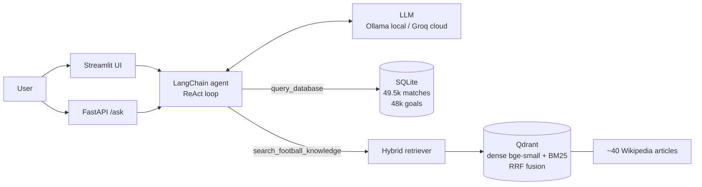

# ⚽ Football Analyst Agent

An **LLM agent** that answers questions about 150 years of international football by
**writing SQL** on a statistics database and **searching Wikipedia with hybrid RAG**,
then citing its sources. Evaluated on a labelled question set, tested in CI, containerised
and deployed.

**🔗 Live demo:** `<your Hugging Face Space URL>`

> "Who was the first African team to reach a World Cup semi-final, and what was their record in that tournament?"
> → the agent searches Wikipedia (Morocco, 2022) **and** queries the database for Morocco's 2022 results.

## Architecture



## Results

Measured with `python eval/run_eval.py` on 26 hand-written questions (15 SQL, 9 RAG, 2 mixed).
Gold answers for SQL questions are computed live from the database, so the test set stays
valid when the dataset is updated. Full report: [`eval/results.md`](eval/results.md).

| Metric | Result |
|---|---|
| Retrieval hit rate@5 — dense / BM25 / **hybrid** | `__` / `__` / `__` |
| Answer accuracy — SQL questions | `__` |
| Answer accuracy — RAG questions | `__` |
| Correct tool routing | `__` |
| Median latency (Groq, Llama 3.3 70B) | `__ s` |

## Key design choices

| Choice | Why |
|---|---|
| **Two tools instead of one** | Numbers must be exact → SQL. History and context are text → RAG. The LLM decides which to call (tool routing is measured). |
| **SQL tool is read-only** | One SELECT only, database opened in read-only mode, row cap. An LLM writes the queries, so they are never trusted. |
| **Errors returned to the agent** | SQL errors come back as text, so the agent fixes its own query (self-correction), with a hard limit of 15 steps. |
| **Commented schema in the prompt** | The SQL comments written in `build_db.py` are what the LLM reads: better schema docs → better SQL. |
| **Hybrid search (dense + BM25, RRF)** | Embeddings catch meaning; BM25 catches exact names and years ("Maracanazo", "1957"). |
| **Configurable LLM** | Ollama locally (free, private), Groq in the cloud (fast, free tier): one environment variable. |
| **Deterministic evaluation** | No LLM-as-judge: gold SQL values and keywords → free, reproducible, runs in CI. |

## Quick start (local, with Ollama)

```bash
python3 -m venv .venv && source .venv/bin/activate
pip install -r requirements.txt
cp .env.example .env                      # LLM_PROVIDER=ollama by default
ollama pull qwen2.5:7b

python scripts/download_data.py           # 1. match data (CSV)
python scripts/build_db.py                # 2. SQLite database
python scripts/build_wiki_corpus.py       # 3. Wikipedia articles
python scripts/build_index.py             # 4. chunks + embeddings -> Qdrant

streamlit run app/ui.py                   # chat UI    -> http://localhost:8501
uvicorn app.api:app --reload              # REST API   -> http://localhost:8000/docs
pytest -q                                 # unit tests (no LLM needed)
python eval/run_eval.py                   # evaluation -> eval/results.md
```

## Docker

```bash
docker compose up --build    # UI on :7860, API on :8000
```

## Deploy on Hugging Face Spaces (Docker, PRO plan)

1. Create a Space at huggingface.co/new-space → SDK **Docker** (requires a PRO subscription).
2. In the Space settings, add the secret `GROQ_API_KEY` and the variable `LLM_PROVIDER=groq`.
3. Push this repository to the Space (the YAML header at the top of this README configures it):
   ```bash
   git remote add space https://huggingface.co/spaces/<username>/football-agent
   git push space main
   ```
The image builds the database and the vector index during the build (~5–10 min the first time).

## Free alternative: Streamlit Community Cloud

1. Get a free Groq API key at console.groq.com/keys.
2. Go to share.streamlit.io, sign in with GitHub and click **Create app**:
   repository `football-agent`, branch `main`, main file `app/ui.py`.
3. In **Advanced settings → Secrets**, paste:
   ```toml
   LLM_PROVIDER = "groq"
   GROQ_API_KEY = "gsk_..."
   ```
4. Deploy. On the first start the app builds the SQLite database and the Qdrant index
   (`app/bootstrap.py`, a few minutes); later starts reuse them.

The Docker image (`docker compose up --build`) is the portable alternative for any server.

## Project structure

```
app/
  config.py      settings from environment variables
  llm.py         Ollama or Groq chat model
  sql_tool.py    safe read-only SQL execution
  rag.py         chunking, Qdrant index, hybrid search
  agent.py       tools + system prompt + agent loop
  api.py         FastAPI
  ui.py          Streamlit
scripts/         data pipeline (download, database, corpus, index)
eval/            question set, answer checks, evaluation runner
tests/           unit tests (fake LLM and fake embeddings)
```

## Limitations and next steps

- The goalscorers dataset is incomplete for older matches, so some scorer totals differ from official records.
- The database has no match stage (group, final...), so "who won the 2010 final" relies on RAG.
- Next: a match-outcome prediction tool (Elo ratings + XGBoost), conversation memory, LLM-as-judge for open answers.

## Data

- Match data: [International football results](https://github.com/martj42/international_results) (Mart Jürisoo).
- Text: Wikipedia articles (CC BY-SA 4.0), cited with their URL in every answer.
